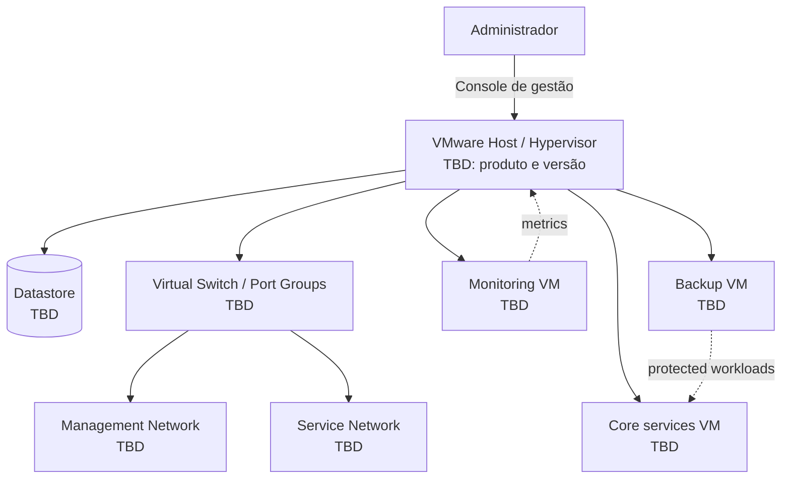

# 01 — VMware Home Lab

[Português](#português) | [English](#english)

## Português

### Objetivo

Documentar o ambiente VMware que suporta este portfólio: capacidade, segmentação lógica, operação segura e serviços reutilizáveis.

### Estado e pressupostos

- Plataforma: VMware — edição e versão `TBD`.
- Hardware, datastore, switches virtuais e redes: `TBD`.
- IPs públicos, credenciais e identificadores de ativos não são publicados.

### Arquitetura

### Implementação e validação

1. Registar host, capacidade e versão no [inventário](../../docs/lab-inventory.md).
2. Definir convenção de nomes para VMs, redes e snapshots.
3. Separar gestão, serviços e laboratório em grupos de portas/redes, quando aplicável.
4. Documentar templates de VM atualizados e com hardening básico.
5. Validar acesso de gestão, conectividade autorizada e espaço disponível.

**Evidência a adicionar:** captura redigida da consola; tabela de VMs sem dados sensíveis; teste de restauração; registo de capacidade.

## English

### Objective

Document the VMware environment supporting this portfolio: capacity, logical segmentation, secure operations, and reusable services.

### Summary

Inventory the host and workloads, standardize naming, segment management and service networks where applicable, maintain hardened VM templates, and validate management access, authorized connectivity, and available capacity. Product/version, host details, storage, and networks remain `TBD` until verified.

