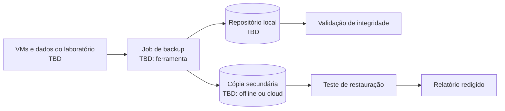

# 02 — Backup & Disaster Recovery

[Português](#português) | [English](#english)

## Português

### Objetivo

Definir uma estratégia de backup e recuperação de desastre para os workloads do laboratório, com metas de recuperação e testes periódicos.

### Âmbito

Ferramenta, destinos, retenção, RPO, RTO e proprietário do processo são `TBD`. O diagrama é um modelo a adaptar depois de validar o ambiente.

### Política base

- Aplicar **3-2-1**: três cópias, dois tipos de suporte, uma cópia fora do local ou isolada.
- Definir RPO e RTO por workload antes de configurar jobs.
- Usar encriptação e menor privilégio quando suportado.
- Testar restaurações regularmente; backup sem teste não é recuperação comprovada.

### Runbook de teste

1. Selecionar workload não crítico.
2. Confirmar ponto de recuperação dentro do RPO.
3. Restaurar para local/rede isolada, quando possível.
4. Validar arranque, acesso e dados esperados.
5. Registar duração, resultado, desvios e ações corretivas.

## English

Define and test backup and disaster recovery for lab workloads. Apply 3-2-1, set RPO/RTO per workload, encrypt and restrict access where supported, and test restores regularly. Tool, target, retention, workload matrix, and objectives remain `TBD` until verified.

