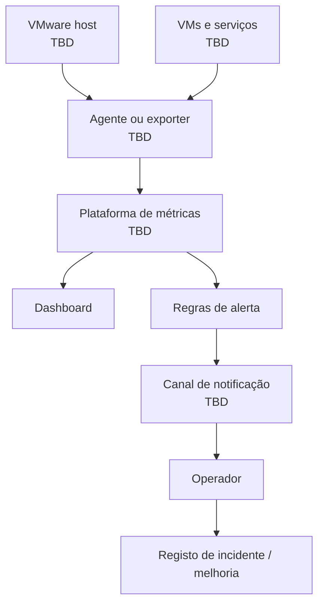

# 03 — Infrastructure Monitoring

[Português](#português) | [English](#english)

## Português

### Objetivo

Implementar observabilidade útil para hosts, VMs, serviços e capacidade: métricas, dashboards e alertas com contexto acionável.

### Plataforma

Ferramenta, versões, retenção, canais de notificação e endpoints são `TBD`. A escolha (por exemplo Prometheus/Grafana, Zabbix ou PRTG) deve ser registada após validação.

| Área | Métrica/estado | Alerta inicial |
| --- | --- | --- |
| Disponibilidade | Host/VM/serviço acessível | Falha de verificação |
| Capacidade | Disco livre | Limite `TBD` |
| Desempenho | CPU e memória | Sustentado acima de `TBD` |
| Backup | Último job e resultado | Falha ou job desatualizado |

**Validação:** mostrar um host e uma VM no dashboard; provar que um alerta de teste chega ao canal; incluir sistema, impacto, severidade e ação sugerida; rever ruído após o período inicial.

## English

Implement actionable baseline observability for hosts, VMs, services, and capacity. Product, versions, retention, thresholds, and notification channel remain `TBD` until verified. Validate with a dashboard, a delivered test alert, contextual alert fields, and alert-noise review.

