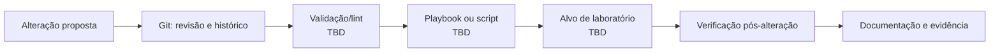

# 04 — Infrastructure Automation

[Português](#português) | [English](#english)

## Português

### Objetivo

Reduzir trabalho manual e risco de configuração através de automação controlada, versionada e validada. O primeiro caso deve ser pequeno, reversível e de baixo risco.

### Ferramentas e âmbito

A ferramenta principal (por exemplo, PowerShell ou Ansible), hosts geridos e método de gestão de segredos são `TBD`. Nunca incluir credenciais no código ou na documentação.

### Primeiro caso recomendado

Automatizar inventário de VMs, verificação de espaço livre ou configuração de uma VM de teste. Definir entradas, resultados esperados, validação e reversão antes de executar.

### Princípios

- Idempotência sempre que possível.
- Menor privilégio; segredos fora do controlo de versões.
- Testar primeiro no laboratório.
- Registar alterações e validar resultados.

## English

Reduce manual work and configuration risk through controlled, versioned, and validated automation. Automate a VM inventory, free-space check, or test-VM configuration first. Define inputs, expected results, validation, and rollback before execution. Tooling, managed hosts, and secrets workflow remain `TBD`.

